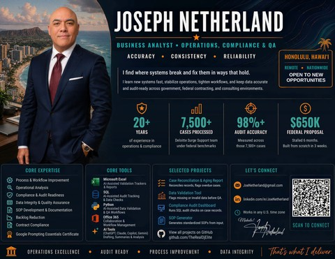

# Business Analyst Operations, Compliance & QA

<b>JOSEPH NETHERLAND</b> 
Honolulu, HI • Remote (U.S.) • Works in any U.S. time zone 
*Accuracy • Consistency • Reliability*

---

## 👤 Background

**I find where systems break and fix them in ways that hold.**

Business Analyst and Operations professional with 20+ years of experience across government, federal contracting, consulting, and private-sector environments. I learn new systems fast and focus on process improvement and data integrity, using Advanced Excel, SQL, and Python in AI-assisted workflows to improve validation, reporting accuracy, and process reliability.

---

## 📄 Quick Intro

A one-page overview of my experience, measurable results, and the operational challenges I've helped organizations solve.

<table>
  <tr>
    <td align="center">
      
       (click to enlarge 11" x 8.5" infographic)
    </td>
  </tr>
</table>

---

## 🔍 What I Build

Built to catch errors before they reach review or reporting, keep records audit-ready, and reduce manual rework through practical validation, workflow automation, and process standardization.

---

## 🛠️ Projects

These projects demonstrate practical approaches to improving data quality, standardizing workflows, and supporting audit-ready operations.

| Project | Problem | Approach | Result |
|---|---|---|---|
| [Case Reconciliation & Aging Report](https://github.com/TheRealDjElite/CaseReconciliationAgingReport) | System and team tracker records out of sync | Python + SQL reconciliation and aging checks with formatted Excel report | Mismatches, missing records, and overdue cases flagged for review |
| [Data Validation Tool](https://github.com/TheRealDjElite/DataValidationTool) | Manual data errors | Python-based field-level validation rules | Errors flagged automatically before manual review |
| [Compliance Audit Dashboard](https://github.com/TheRealDjElite/ComplianceAuditDashboard) | Missing or invalid case data | SQL schema + audit and data integrity queries | Data issues and audit-flagged cases surfaced for review |
| [Eligibility Case Review Tracker](https://github.com/TheRealDjElite/EligibilityCaseReviewTracker) | Incomplete case records | Python-based case review flags with notes | Incomplete records flagged for review |
| [SOP Generator](https://github.com/TheRealDjElite/SopGenerator) | Documentation gaps | Automated Markdown SOP generation | Consistent process documentation |

---

## 💻 Built With

- Python - data validation, case review flagging, and reconciliation (pandas, openpyxl), SOP generation
- SQL (MySQL, SQLite) - schema design, audit, data integrity, reconciliation, and aging queries
- Excel - case review input template, formatted reconciliation report with formulas and conditional formatting
- AI-assisted development

---

## 🌐 Connect

Interested in opportunities involving business analysis, operations, compliance, QA, data quality, and process improvement in regulated or high-volume environments.

