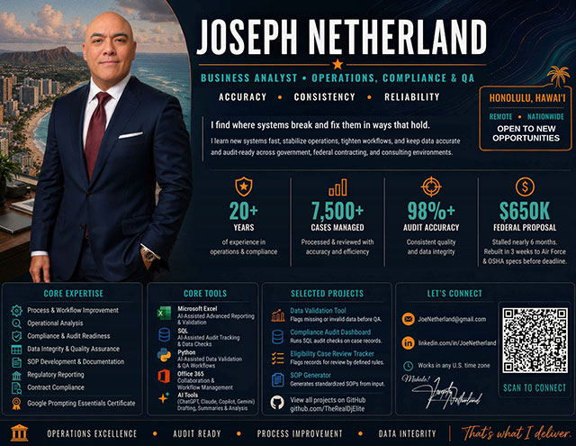

# Business Analyst Operations, Compliance & QA

<b>JOSEPH NETHERLAND</b> 
Honolulu, HI • Remote (U.S.) • Works in any U.S. time zone 
*Accuracy • Consistency • Reliability* 
Operations • Compliance • QA

---

## 👤 Background

**I find where systems break and fix them in ways that hold.**

Business Analyst and Operations professional with 20+ years of experience across government, federal contracting, consulting, and private-sector environments. I learn new systems fast and focus on process improvement and data integrity, using Advanced Excel, SQL, and Python in AI-assisted workflows to improve validation, reporting accuracy, and process reliability.

**Highlights:**
- Processed and reviewed 7,500+ Medicaid cases in IES with 98%+ audit accuracy
- Rebuilt a $650K federal proposal that had stalled for nearly 6 months, completing it in 3 weeks to Air Force specs and OSHA regulations before the deadline
- Developed SOPs, validation trackers, and training materials to improve consistency and reduce errors

---

## 📄 Quick Intro

A one-page overview of my experience, measurable results, and the operational challenges I've helped organizations solve.

<table>
  <tr>
    <td align="center">
      
       (click to enlarge 11" x 8.5" infographic)
    </td>
  </tr>
</table>

---

## 🔍 What I Build

Built to catch errors before they reach review or reporting, keep records audit-ready, and reduce manual rework through practical validation, workflow automation, and process standardization.

---

## 🛠️ Projects

These projects demonstrate practical approaches to improving data quality, standardizing workflows, and supporting audit-ready operations.

| Project | Problem | Approach | Result |
|---|---|---|---|
| [Data Validation Tool](https://github.com/TheRealDjElite/DataValidationTool) | Manual data errors | Python-based field-level validation rules | Errors flagged automatically before manual review |
| [Compliance Audit Dashboard](https://github.com/TheRealDjElite/ComplianceAuditDashboard) | Inconsistent reporting | SQL schema + audit queries | Audit-flagged cases surfaced for review |
| [Eligibility Case Review Tracker](https://github.com/TheRealDjElite/EligibilityCaseReviewTracker) | Incomplete case records | Python-based missing-data flagging | Incomplete records flagged for review |
| [SOP Generator](https://github.com/TheRealDjElite/SopGenerator) | Documentation gaps | Automated Markdown SOP generation | Consistent process documentation |

---

## 💻 Tools & Systems

- Advanced Excel (AI-assisted validation, reporting, workflow support)
- SQL (AI-assisted audit tracking and data checks)
- Python (AI-assisted data validation and QA workflows)
- AI Tools: ChatGPT, Claude, Copilot, Gemini (drafting, summaries, analysis)
- Office 365
- AWS Cloud Foundations (Coursework)
- Google Prompting Essentials (Certificate)

---

## 🌐 Connect

Interested in opportunities involving business analysis, operations, compliance, QA, data quality, and process improvement in regulated or high-volume environments.

